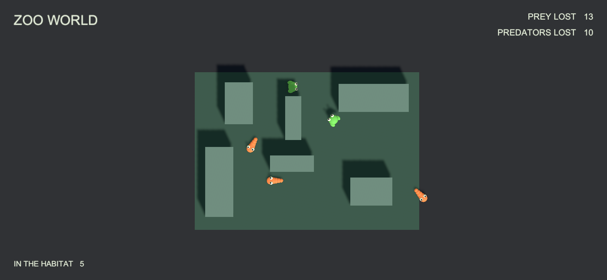
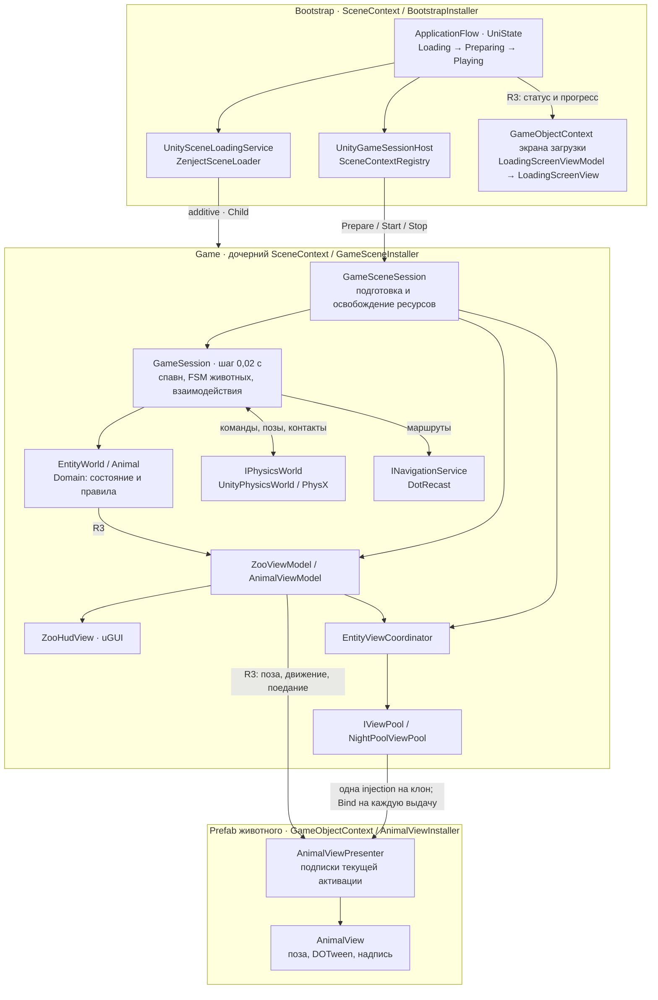

# Zoo World

Небольшая симуляция зоопарка на Unity. Животные появляются на площадке, обходят препятствия и взаимодействуют друг с другом. Лягушки прыгают, змеи перемещаются по земле и поедают добычу. Интерфейс показывает число живых и съеденных животных.

[Запустить демо](https://pavelfoxx.com/zoo-world)

Проект использует **Unity 6000.3.9f1**. Целевая платформа — **WebGL / IL2CPP**. Игровые правила и симуляцию также можно запустить отдельно в **.NET 8**.



## Как запустить

1. Откройте проект в Unity 6000.3.9f1 и дождитесь восстановления пакетов и завершения компиляции.
2. Откройте сцену `Assets/Zoo World/Scenes/Bootstrap.unity`.
3. Нажмите **Play**.

`Bootstrap` создаёт зависимости и экран загрузки. Затем приложение загружает сцену `Game`, подготавливает навигацию и физику, подключает представления и запускает спавн.

В `Game` уже находятся земля, препятствия, камера и интерфейс. `Ground` задаёт логическую границу площадки. Пол и запечённая навигация продолжаются за её пределами, а обычные маршруты могут уходить на метр за край. Раз в секунду симуляция проверяет позиции животных и переключает оказавшихся снаружи в состояние возврата. Положение и параметры камеры задаются в сцене `Game`.

Вызов `ZooBootstrap.Restart()` завершает текущую сессию и загружает новую. При ошибке загрузки на экране появляется кнопка **Retry**.

## Как устроен проект



`Bootstrap` и `Game` содержат по одному `SceneContext` с сериализованными installer-компонентами. `BootstrapInstaller` хранит каталог, seed и флаг его рандомизации; `ZooBootstrap` получает зависимости через `[Inject]` и запускает асинхронный flow. `UnitySceneLoadingService` использует `ZenjectSceneLoader` с `LoadSceneRelationship.Child`: Game наследует зависимости Bootstrap.

`GameSceneInstaller` явно регистрирует `GameSceneBindings`, HUD, пул и сервисы сессии. `UnityGameSessionHost` получает область загруженной сцены через `SceneContextRegistry`; разрешение `GameSceneSession` остаётся на границе Composition. Физика, навигация, ViewModel и coordinator создаются при подготовке. `GameSceneSession` освобождает их при остановке, отмене и выгрузке сцены. Остановленную область нельзя подготовить повторно: Retry выгружает Game и загружает новую.

Экран загрузки имеет собственный `GameObjectContext` и `LoadingScreenViewModel`. Prefab животного содержит `GameObjectContext`, `AnimalViewInstaller` и ссылку на `AnimalView`; локальный `AnimalViewPresenter` подключает R3-потоки модели. `NightPoolViewPool` внедряет зависимости клона один раз и выдаёт presenter из его контейнера. Каждая выдача вызывает `Bind` с новой моделью, возврат через `OnDisable` завершает подписки, таймер надписи и tween. NightPool активирует клон до внедрения зависимостей, поэтому pooled-компоненты используют их только после выдачи, а не в `Awake`/`OnEnable`.

**Domain** хранит состояние животных и игровые правила. **Application** управляет сценариями, поведением и временем симуляции. Эти слои запускаются в обычном .NET. **Адаптеры Unity** связывают их с физикой, сценами и изображением. **Composition** создаёт объекты и передаёт им зависимости.

Каждая часть отвечает за конкретную задачу.

| Задача | Где находится |
| --- | --- |
| Загрузка, подготовка, игра и перезапуск | `ApplicationFlow`, состояния UniState |
| Сборка областей жизни сцен | `BootstrapInstaller`, `GameSceneInstaller` |
| Подготовка и освобождение Unity-сессии | `GameSceneSession`, `GameSessionFactory` |
| Связь Bootstrap с загруженной сценой | `UnityGameSessionHost`, `SceneContextRegistry` |
| Подписки представления животного | `AnimalViewPresenter` в `GameObjectContext` |
| Порядок фиксированного шага симуляции | `GameSession` |
| Выбор животного и свободной точки спавна | `AnimalSpawner` |
| Интервал между появлениями | `SpawnScheduler` |
| Создание и удаление тел и FSM животных | `AnimalLifecycle` |
| Наземное поведение и поиск маршрута | `GroundAnimalBrain`, его `WanderState` и `ReturnState` |
| Следование маршруту, интервалы движения и отдыха | `MovementMachine`, `TravelState` и `RestState` |
| Выбор реакции на столкновение | `InteractionResolver`, порядок `InteractionType` |
| Выполнение поедания и отскока | `EatingInteraction` и `BounceInteraction` |
| Тексты и прогресс экрана загрузки | `LoadingScreenViewModel` |

Симуляция работает с шагом **0,02 секунды**. Физика подтверждает положение тела, модель сохраняет его, а представление отображает изменения через R3. Высота прыжка анимируется DOTween. У каждого животного собственные состояния поведения и движения.

Успешно созданная `GameSession` владеет физикой и навигацией и освобождает их при завершении. Возврат представления в пул отменяет его подписки, таймеры и анимации. При следующей выдаче из пула начинается новое время жизни.

`ApplicationFlow` запускает `GameState`, который владеет циклом загрузки, подготовки и игры. Состояния `LoadingState`, `PreparingState` и `PlayingState` публикуют статус для экрана загрузки. При завершении сессии `GameState` останавливает её и выгружает сцену.

`AnimalBrain` задаёт жизненный цикл NPC и отмену активной операции. `AnimalLifecycle` выбирает `FlyingAnimalBrain` для конфигурации `FlightMovement`, а `GroundAnimalBrain` — для остальных способов движения. Состояния `WanderState` и `ReturnState` принадлежат конкретному мозгу и выбирают цель прогулки или возврата.

Наземный мозг использует `INavigationService` и перепланирует маршрут при изменении навигации. Каждый мозг запускает вложенную FSM `MovementMachine`, которая исполняет планы `IMovementBehavior`. Состояние `TravelState` управляет движением, `RestState` — паузой между его интервалами.

## Где искать файлы

Весь собственный Unity-контент находится в `Assets/Zoo World`.

```text
Assets/Zoo World/
├── Scripts/
│   ├── Domain/                  Состояние мира, животные и правила
│   │   └── Movement/Impl/       Линейное движение, прыжки и полёт
│   ├── Application/             Сценарии, FSM, спавн и ViewModel
│   │   ├── Animals/            Мозг, жизненный цикл и движение NPC
│   │   │   ├── Ground/States/  Прогулка и возврат по навигации
│   │   │   ├── Flying/States/  Прогулка и возврат в полёте
│   │   │   └── Movement/States/ Движение по маршруту и отдых
│   │   ├── Lifecycle/States/   Состояния приложения
│   │   └── Interactions/Impl/  Поедание и отскок
│   ├── Adapters/
│   │   ├── DotRecast/           Поиск маршрутов
│   │   ├── UnityPhysics/        Физические тела и контакты
│   │   └── Unity/               SO, сцены, пул и представления
│   ├── Composition/             Сборка зависимостей Zenject
│   │   ├── Installers/          Регистрации SceneContext и GameObjectContext
│   │   └── Sessions/            Подготовка и владение ресурсами Game
│   └── Configuration/           Схема JSON и проверка настроек
├── Editor/
│   ├── Navigation/              Запекание и проверка навигации
│   │   └── Baking/              Recast baker для Unity и .NET
│   └── Export/                  Экспорт настроек в JSON
├── Settings/                    Настройки животных и подсистем
├── Prefabs/                     Животные и физические тела
├── Art/Materials/               Материалы
├── Scenes/                      Bootstrap и Game
└── Tests/                       EditMode и PlayMode

Tools/Headless/                   .NET-версия симуляции и консольный запуск
Tests/Headless/                   Независимые тесты
Exports/zoo-world.json            Готовый пример настроек
```

Состояния лежат в отдельных файлах подпапок `States` и остаются закрытыми вложенными типами владельца через `partial`. Интерфейс загрузки находится в `Adapters/Unity/Presentation/Loading`. Сборки `.asmdef` задают границы слоёв.

## Как добавить функциональность

**Новый вид животного с готовым поведением**

1. Создайте настройки вида в `Settings/Animals/<Species>` со стабильным `TypeId`.
2. Укажите тело, движение, поведение, взаимодействия и навигационный профиль. Для prefab используйте существующее животное как образец: `AnimalView`, `GameObjectContext` и `AnimalViewInstaller` с назначенной ссылкой на View.
3. Добавьте определение в `Settings/Catalogs/Animals.asset`.

Для такого вида достаточно настроек. Общие ScriptableObject хранят конфигурацию, а состояние конкретного животного живёт в модели и его FSM.

**Новое правило или способ движения**

Для нового движения добавьте реализацию `IMovementBehavior` в `Scripts/Domain/Movement/Impl` и настройку SO в `Scripts/Adapters/Unity/Configuration/Movement`. План движения задаёт скорость, длительность, паузу и визуальную высоту прыжка. Если способ движения требует собственной навигации или управления, реализуйте соответствующий мозг и подключите его в `AnimalLifecycle`.

Столкновения передаются через R3 в resolver взаимодействий.

```text
IPhysicsWorld.Contacts → GameSession.Collisions (CollisionEvent)
                     → InteractionResolver → первое подходящее IInteraction.Execute
```

`CollisionEvent` содержит двух столкнувшихся участников (`First`, `Second`). Сессия публикует его после завершения физического шага, чтобы действие могло безопасно удалить тело. `InteractionResolver` сам подписывается на событие и освобождает подписку при завершении сессии.

Resolver один раз сортирует реализации по `InteractionType`: меньшее значение проверяется раньше. Сейчас `Eating = 0`, `Bounce = 100`. Он вызывает `CanExecute` по порядку и передаёт столкновение в `Execute` первого подходящего взаимодействия. Если подходящих нет, игровое действие не выполняется. Повторная регистрация одного типа отклоняется.

`EatingInteraction` выбирает победителя и вызывает `EntityWorld.Eat`. `BounceInteraction` выбирает силу отскока и отправляет импульсы в `IPhysicsWorld`. Для новой реакции добавьте значение enum, реализацию `IInteraction` в `Scripts/Application/Interactions/Impl` и её регистрацию в `GameSession` либо передайте фабрику `createInteractions`. Зависимости действия передаются через конструктор.

Правила взаимодействий задаются в `InteractionProfileSO.Roles` по пищевой роли цели (`Prey` или `Predator`). Если для роли нет записи, подходящего правила нет. Для новой реакции с параметрами добавьте реализацию `IInteractionRule` и соответствующий SO. Для экспорта нового правила дополните преобразование в `Editor/Export` и загрузку в `Scripts/Configuration`.

PhysX использует тот же выбор взаимодействия для `SuppressesPhysicalResponse`. Метод `CanExecute` должен проверять условия без изменения состояния, расходования случайных чисел и аллокаций. Поедание подавляет физическое расталкивание, а отскок сохраняет его. Если правила обоих участников разрешают съесть друг друга, `EatingInteraction.Execute` выбирает победителя случайно. Если поедание разрешено только одному, побеждает он.

`EatingInteraction` передаёт текст сообщения в событие `AnimalMeal.Message`. Текст задаётся параметром `message` при создании взаимодействия, в том числе через фабрику `GameSession.createInteractions`. Событие проходит через `ZooViewModel` и `AnimalViewModel.Ate` до `AnimalViewPresenter` и `AnimalView`. Пустое сообщение обновляет игровые счётчики без новой надписи. При возврате View в пул надпись очищается, а её отложенное скрытие отменяется.

**Новое поведение**

Добавьте наследника `AnimalBrain` в `Application/Animals` и подключите его создание в `AnimalLifecycle`. Поведение, выбор маршрута и запуск движения размещайте в конкретной реализации. Её состояния храните в подпапке `States`. UniState управляет переходами, UniTask — отменяемыми операциями. Время и случайность берутся из симуляции, а доступ к физике и навигации идёт через их интерфейсы. Новое экспортируемое поведение также требует поддержки в конфигурации и её загрузчике.

**Новый элемент интерфейса**

Добавьте нужные данные во ViewModel и подпишите View на изменения R3. Unity-компонент отвечает за отображение и ввод, игровые решения выполняются в Domain и Application.

## Как изменить уровень

1. Откройте `Game.unity` и измените препятствия.
2. Добавьте новые BoxCollider в `GameSceneBindings.LevelColliders`.
3. Выполните **Zoo → Bake current level navigation**.
4. Сохраните сцену.

Запекание учитывает размеры тела и настройки навигационного профиля. Перед сборкой и экспортом проект сравнивает хеш текущей геометрии с запечёнными данными. Устаревшие данные требуют повторного запекания.

`NavigationAuthoring` выполняет запекание, `NavigationDataValidation` проверяет актуальность, а `NavigationBuildValidator` подключает проверку к сборке Unity. Геометрию и хеш собирает `NavigationBakeSource`.

## Запуск без Unity

В Unity выберите **Zoo → Export simulation settings to JSON**. Экспорт включает настройки животных, физическую геометрию и навигационную сетку. Открытые сцены читаются с текущими правками. Закрытые сцены открываются временно для чтения. Старые экспорты с граничными стенками нужно создать заново, чтобы в них работал выход за границу площадки.

Текущая версия JSON-схемы — `2`. Взаимодействия содержат только `interactions.byRole`. Старые файлы версии `1` нужно экспортировать заново. Загрузчик отклоняет старую версию и неизвестное поле `byType`.

Готовый пример можно запустить из корня проекта.

```powershell
dotnet run --project Tools/Headless/Runner -- Exports/zoo-world.json --seconds 60 --seed 1701
```

Команда выполняет 60 секунд симуляции и выводит JSON с итоговыми счётчиками и позициями. Одинаковый seed позволяет повторять прогон в той же среде.

.NET использует те же исходники Domain и Application, реальный DotRecast и физический адаптер **BepuPhysics 2.4.0**. Траектории BEPU и Unity PhysX могут различаться. Подавление физического расталкивания через `SuppressesPhysicalResponse` реализовано в Unity/PhysX. Headless-адаптер BEPU пока этот флаг не применяет.

Экспорт поддерживает статические BoxCollider с положительным масштабом без сдвигового искажения, сферические тела животных, линейное движение, прыжки, полёт, Wander/Return, Eat и Bounce. Новый тип должен поддерживаться и экспортёром, и загрузчиком JSON.

## Проверки

Команда для независимых тестов из корня проекта приведена ниже.

```powershell
dotnet test Tests/Headless/Zoo.Headless.Tests.csproj
```

В Unity откройте Test Runner и выполните **EditMode** и **PlayMode**. Перед PlayMode-прогоном уберите принудительную стартовую сцену: `EditorSceneManager.playModeStartScene` должен быть `null`. Иначе Unity загружает Bootstrap вместо служебной сцены Test Runner, и тесты не стартуют. После прогона настройку можно восстановить.

Headless-проверки покрывают логику взаимодействий по ролям, отмену операций NPC и загрузку JSON. Unity-проверки дополнительно покрывают физику, экспорт сцен и повторное использование представлений. Для проверки целевой платформы нужна сборка WebGL/IL2CPP с фактическим уровнем stripping и запуск в браузере.

## Основные зависимости

| Библиотека | Назначение |
| --- | --- |
| UniState 1.12.1 | Состояния приложения и животных |
| UniTask 2.5.11 | Асинхронные операции и отмена |
| R3 1.3.1 | События и привязки MVVM |
| Zenject / Extenject 9.2.0 | Сборка зависимостей |
| NightPool 3.1.1 | Пул Unity-объектов |
| DOTween 1.3.045 | Анимации представления |
| DotRecast 2026.3.1 | Запекание и поиск маршрутов |

Версии UPM закреплены в `Packages/packages-lock.json`, NuGetForUnity — в `Assets/packages.config`, .NET — в `packages.lock.json` соответствующих проектов. Локальные изменения UniState описаны в его PATCHES.md.

Для WebGL игровая логика работает в основном потоке. Ожидания Unity PlayerLoop находятся в адаптерах, а длительные операции получают явный CancellationToken.
